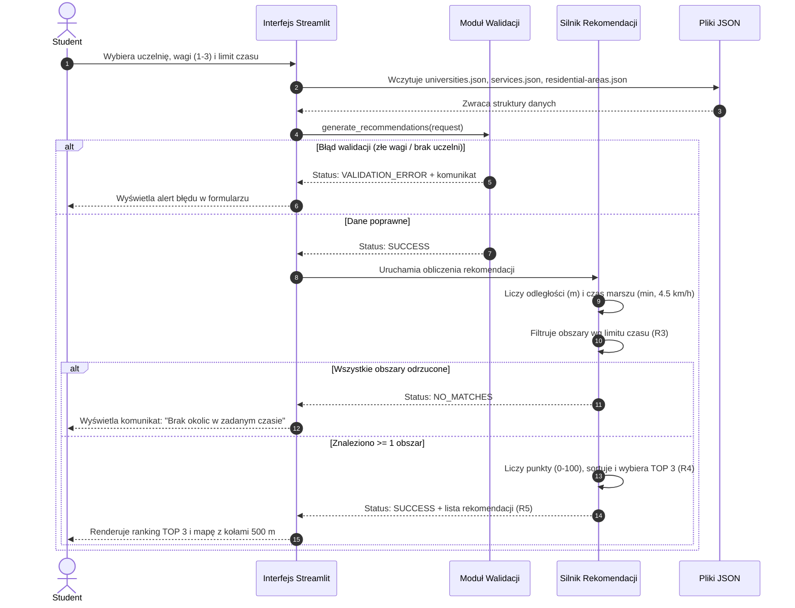
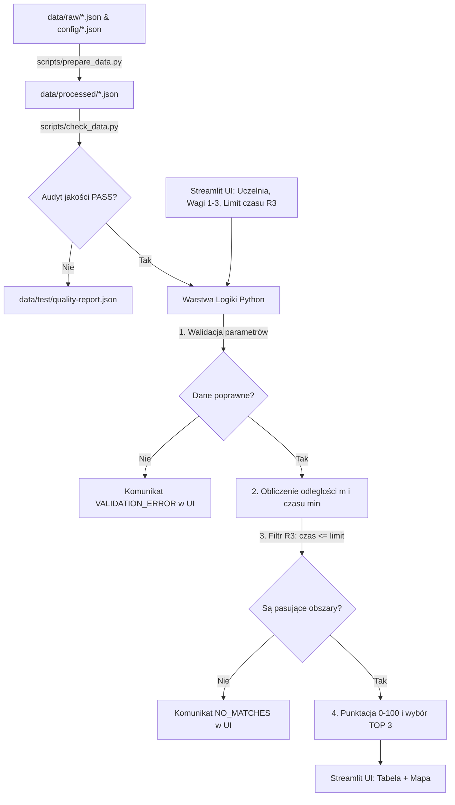

# Architektura systemu — Laboratorium 5

## 1. Wybór architektury i granice systemu
System rekomendacji okolic zamieszkania dla studentów w Rzeszowie został zaprojektowany jako **aplikacja analityczna z lekkim interfejsem graficznym w Streamlit**, przetwarzająca dane z plików **JSON i CSV**.

### Uzasadnienie wyboru
* Dane źródłowe (OpenStreetMap) oraz przetworzone (usługi i uczelnie) są zapisane w spójnym formacie JSON.
* Skala danych (528 obiektów: 28 uczelni, 500 usług oraz 25 obszarów) pozwala na szybkie obliczenia in-memory w języku Python bez narzutu relacyjnej bazy danych czy osobnego serwera REST API.
* **Streamlit** zapewnia czytelny interfejs graficzny (formularz preferencji, mapa z kołami o promieniu 500 m, tabela rankingu) przy zachowaniu pełnej spójności technologicznej w języku Python.

### Granice i odpowiedzialności poszczególnych modułów
1. **Warstwa Prezentacji (Streamlit UI):**
   * **Odpowiedzialność:** Pobieranie preferencji od studenta (wybór uczelni, wagi 1–3, maksymalny czas dojścia), renderowanie mapy Rzeszowa z zaznaczonymi obszarami (promień 500 m) oraz wyświetlanie tabeli rankingu TOP 3 wraz z uzasadnieniem i komunikatami błędów.
   * **Granica:** Nie wykonuje obliczeń odległości, filtrowania ani punktacji; komunikuje się z warstwą logiki wyłącznie przez zdefiniowany kontrakt interfejsu.
2. **Warstwa Logiki Analitycznej (Silnik Python w `scripts/`):**
   * **Odpowiedzialność:** Walidacja danych wejściowych, obliczanie odległości w linii prostej i szacowanego czasu marszu (4,5 km/h), filtrowanie obszarów przekraczających limit czasu (**R3**), obliczanie punktacji metodą Weighted Scoring oraz generowanie tekstowego uzasadnienia (**R5**). KNN pozostaje metodą porównywaną w eksperymencie Lab 4.
   * **Granica:** Działa bezstanowo na przekazanych parametrach; nie zarządza widokiem ani stanem sesji przeglądarki.
3. **Warstwa Danych i Konfiguracji (`data/` oraz `config/`):**
   * **Odpowiedzialność:** Trwałe przechowywanie surowych i przetworzonych danych o uczelniach, usługach, obszarach mieszkalnych oraz eksport raportów badawczych w `results/`.
   * **Granica:** Brak logiki biznesowej; pliki są wyłącznie odczytywane przez silnik rekomendacji.

---

## 2. Przypadek użycia: UC-01 — Generowanie rekomendacji okolic dla studenta

* **Aktor główny:** Student szukający mieszkania w Rzeszowie.
* **Cel:** Otrzymanie rankingu maksymalnie 3 najlepiej dopasowanych okolic mieszkalnych na podstawie wybranych preferencji i limitu czasu dojścia.
* **Powiązane wymagania:** R1, R2, R3, R4, R5, R6.

### Przebieg główny
1. Student w interfejsie Streamlit wybiera budynek uczelni (R1), ustawia wagi dla kryteriów w skali 1–3 (R2) oraz wybiera limit czasu dojścia: 15, 30, 45 min lub brak limitu (R3).
2. Interfejs przekazuje słownik parametrów wejściowych do silnika analitycznego.
3. Moduł walidacji sprawdza poprawność parametrów oraz integralność plików JSON.
4. Silnik oblicza odległości w linii prostej (w metrach) od środków 25 obszarów do wybranej uczelni i usług, przeliczając odległość do uczelni na szacowany czas marszu (prędkość 4,5 km/h).
5. Filtr czasu (R3) odrzuca obszary, dla których czas dojścia przekracza podany limit.
6. Silnik oblicza ocenę (0–100 pkt), sortuje obszary malejąco (przy remisie decyduje `area_id` w odpowiedzi) i wybiera maksymalnie 3 najlepsze okolice (R4).
7. Interfejs Streamlit wyświetla listę TOP 3 z ocenami, czasem marszu, uzasadnieniem (R5) oraz zaznacza koła o promieniu 500 m na mapie.

### Przebieg alternatywny / Wyjątki
* **Brak dopasowań (R3):** Gdy żaden obszar nie mieści się w limicie czasu, system zwraca status `NO_MATCHES` i wyświetla w Streamlit komunikat informujący o konieczności zwiększenia limitu czasu.
* **Nieprawidłowe dane wejściowe:** Gdy wybrany identyfikator uczelni nie istnieje lub wagi są spoza zakresu 1–3, system zwraca status `VALIDATION_ERROR` z opisem błędu.

### Kryteria odbioru UC-01
Przypadek użycia uznaje się za poprawnie zrealizowany, gdy spełnione są wszystkie poniższe warunki:
1. Dla poprawnych danych wejściowych system zwraca od 1 do 3 obszarów posortowanych malejąco według `score`.
2. Żaden ze zwróconych obszarów nie ma `walk_time_to_univ_min` większego niż zadeklarowany `max_walk_time_minutes`.
3. Przy dwóch obszarach z identycznym wynikiem punktowym wyżej w rankingu znajduje się obszar o leksykograficznie mniejszym `area_id`.
4. Gdy limit czasu wynosi 15 min i żaden obszar nie mieści się w limicie, system zwraca obiekt ze statusem `NO_MATCHES` oraz czytelny komunikat w UI. Limit 15 min jest akceptowaną wartością wejściową; limit 1 min skutkuje `VALIDATION_ERROR`.
5. Każdy wynik zawiera uzasadnienie zgodne z punktacją oraz zastrzeżenie o szacowaniu odległości w linii prostej od środka obszaru.

---

## 3. Diagramy UML i przepływu danych

### 3.1. Diagram sekwencji (Mermaid)

### 3.2. Diagram przepływu danych (Data Flow)

---

## 4. Kontrakt interfejsu (Typy danych, jednostki, wynik i obsługa błędów)

### 4.1. Struktura wejściowa (Request)
Przekazywana z interfejsu Streamlit do funkcji `generate_recommendations(request: dict, engine=None) -> dict`:

* `location_id` (`str`, wymagane) — identyfikator wybranego budynku lub kampusu z pola `id` w `universities.json` (np. `"way/208515700"`).
* `max_walk_time_minutes` (`int | None`, wymagane) — maksymalny czas dojścia pieszo w minutach przy prędkości 4,5 km/h (`15`, `30`, `45` lub `None` dla braku limitu).
* `weights` (`dict[str, int]`, wymagane) — wagi ważności w skali całkowitej `1–3` dla kluczy: `"university"`, `"shop"`, `"bus_stop"`, `"park"`.

Interfejs przekazuje wcześniej wczytany obiekt `RecommendationEngine` przez parametr `engine`. Gdy go pominięto, funkcja ładuje dane z plików projektu.

### 4.2. Struktura wyjściowa (Response)
* `status` (`str`) — kod wyniku: `"SUCCESS"`, `"NO_MATCHES"`, `"VALIDATION_ERROR"` lub `"DATA_ERROR"`.
* `message` (`str`) — komunikat tekstowy w języku polskim dla użytkownika.
* `disclaimer` (`str`) — stałe zastrzeżenie, że odległości są liczone w linii prostej od środka obszaru, a czas dojścia jest szacowany przy prędkości 4,5 km/h bez uwzględniania rzeczywistych tras pieszych, przejść i przeszkód terenowych. Promień obszaru jest zwracany osobno w polu `radius_m` każdego rekordu rekomendacji.
* `recommendations` (`list[dict]`) — lista od `0` do `3` obszarów posortowana malejąco według `score`, gdzie każdy element zawiera:
  * `rank` (`int`: `1..3`), `area_id` (`str`), `area_name` (`str`), `district` (`str`),
  * `center_lat` (`float`, stopnie WGS84), `center_lon` (`float`, stopnie WGS84), `radius_m` (`int`, stała `500` m),
  * `score` (`float`, punkty `0.00–100.00`), `walk_distance_m` (`float`, metry `>= 0.0`), `walk_time_to_univ_min` (`float`, minuty `>= 0.0`),
  * `distances_m` (`dict[str, float]`, metry `>= 0.0` dla kluczy `university`, `shop`, `bus_stop`, `park`),
  * `scores` (`dict[str, float]`, oceny cząstkowe `0.00–100.00` dla kluczy `university`, `shop`, `bus_stop`, `park`),
  * `justification` (`str`, wygenerowane uzasadnienie zgodnie z wymaganiem R5).

### 4.3. Kody i obsługa błędów
* `VALIDATION_ERROR`: nieistniejące `location_id`, waga spoza zbioru `{1, 2, 3}` lub limit spoza `{15, 30, 45, None}` → zatrzymanie obliczeń i wyświetlenie `st.error` w UI.
* `DATA_ERROR`: Brak plików w `data/processed/`, uszkodzony JSON lub brak wymaganych pól przy starcie aplikacji: zatrzymanie uruchomienia i wyświetlenie komunikatu błędu w interfejsie (`st.error`) z informacją o sprawdzeniu danych i uruchomieniu `scripts/prepare_data.py`.
* `NO_MATCHES`: poprawne dane wejściowe, ale wszystkie 25 obszarów przekracza `max_walk_time_minutes` → zwrócenie pustej listy `recommendations: []` i wyświetlenie `st.warning` w UI.

---

## 5. Model logiczny i fizyczny danych

### 5.1. Model logiczny (Encje i relacje)
* **Uczelnia (`UniversityLocation`):** Konkretny budynek lub kampus w Rzeszowie (1 uczelnia może mieć wiele lokalizacji).
* **Usługa (`ServicePoint`):** Punkt użyteczności publicznej z kategorii `shop`, `bus_stop` lub `park`.
* **Obszar mieszkalny (`ResidentialArea`):** Okrągły obszar o środku geograficznym i stałym promieniu 500 m w jednym z 20 osiedli Rzeszowa.
* **Rekomendacja (`RecommendationResult`):** Wyliczany w pamięci wynik łączący `ResidentialArea` (N) z `UniversityLocation` (1) oraz najbliższymi `ServicePoint` (M).

### 5.2. Model fizyczny (Pliki i typy danych, kodowanie UTF-8)
1. `data/processed/universities.json` (28 rekordów): `id` (`string`, PK), `university` (`string`), `name` (`string`), `address` (`string`), `latitude` (`float64`), `longitude` (`float64`), `location_type` (`string`), `coordinate_type` (`string`), `osm_url` (`string`).
2. `data/processed/services.json` (500 rekordów): `id` (`string`, PK), `category` (`string`: `shop|bus_stop|park`), `name` (`string`), `name_missing` (`bool`), `address` (`string | null`), `latitude` (`float64`), `longitude` (`float64`).
3. `config/residential-areas.json`: pole dokumentu `radius_m` (`int`, wartość `500`) oraz 25 rekordów `areas[]` z polami `id` (`string`, PK), `name` (`string`), `district` (`string`), `latitude` (`float64`) i `longitude` (`float64`). W odpowiedzi API identyfikator rekordu jest udostępniany jako `area_id`.
4. `results/lab4/*.csv` oraz `results/lab6/*.csv`: pliki tabelaryczne CSV z wynikami porównań algorytmów.

---

## 6. Wersjonowanie danych, konfiguracji i wyników
1. **Wersjonowanie w Git:** Pliki surowe (`data/raw/`), przetworzone (`data/processed/`), konfiguracyjne (`config/`) i testowe (`data/test/`) są śledzone w repozytorium Git.
2. **Metadane źródłowe OSM:** Surowe pliki zachowują znacznik czasu pobrania (`osm3s.timestamp_osm_base`).
3. **Wersjonowanie wyników:** Wyniki zapisywane są w podkatalogach `results/` według etapów (np. `results/lab4/knn/`).
4. **Determinizm:** `scripts/prepare_data.py` sortuje rekordy rosnąco po `id`, a `scripts/verify_repeatability.py` porównuje wynik z `data/test/repeatability-reference/`.

---

## 7. Kontrola spójności i przegląd dokumentacji
- Dokumentacja jest odniesiona do `docs/data-dictionary.md`, `docs/processing.md`, `docs/area-name-audit.md` oraz zaktualizowanego `docs/problem.md`, a wymagania R1–R6 są odwzorowane w kontrakcie interfejsu i kryteriach odbioru UC-01.
- Część uwag zgłoszonych podczas przeglądu architektury (Issue #8) została uwzględniona w kodzie i opisie (m.in. pola `walk_distance_m` i `scores` w odpowiedzi oraz rozróżnienie limitów 15 min i 1 min), natomiast pełna spójność wszystkich gałęzi roboczych (`serhii-recommendation-engine`, `valentyna-data-validation`, `dana-lab6-interface`, `paula-lab8-report`) następuje po ich scaleniu do `main` i ponownym uruchomieniu testów.
- Etykiety nazw obszarów w `config/residential-areas.json` mają charakter orientacyjny (patrz `docs/area-name-audit.md`) i mogą różnić się od przypisanego pola `district`.